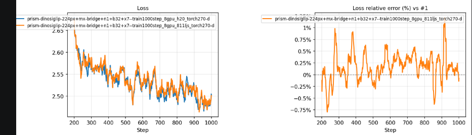
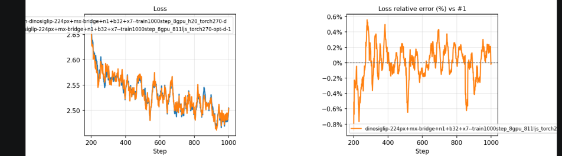

# OpenVLA 改动项说明

随包 OptimizationConfig `model.openvla.base.hcu` 交付以下 Group。这些 Group 只替换既有函数或类型，不新增模型结构、不修改损失语义。

关联 Issue：无。

数值精度验证使用的配置（与随包默认相反）：关闭 `openvla.dataloader.spawn`，开启 `openvla.reproducibility.data_order` 与 `openvla.reproducibility.determinism`。

## 1. 模型适配项

| Group | 优化内容 | 关键选项（随包取值） |
| --- | --- | --- |
| `openvla.bf16_support` | bf16 支持检测兼容 ROCm/HIP | — |

### 1.1 bf16 支持检测兼容 ROCm/HIP

`check_bloat16_supported()` 在上游实现里遇到 `torch.version.cuda is None` 直接返回 `False`，导致 ROCm/HIP 环境被误判为不支持 bf16。本 Group 按后端分支：CUDA 走原逻辑（CUDA ≥ 11.0 且 NCCL ≥ 2.10），HIP 改用 `torch.cuda.is_available()` 判断，两者都不满足才返回 `False`。本项属于纯修复，无性能与数值改动。

#### 性能收益

本项没有独立的性能数字，它是 bf16 训练的前置条件：没有它，上游 `prismatic/training/strategies/base_strategy.py` 里的 `assert check_bloat16_supported()` 会直接中止，bf16 混合精度训练无法启动。因此本节后面所有 bf16 测量都以本项生效为前提。

## 2. 性能优化项

| 优化项 | 内容解释 | 性能收益(sample/s) |
| --- | --- | --- |
| `openvla.compile.fsdp1` | FSDP1 逐层 `torch.compile` + 视觉塔整塔 compile | 80.43（1.20×） |
| `fsdp zero3 -> zero2` | FSDP full shard改为shard grad op，降低通信开销 | 83.91（1.26×） |
| `openvla.adamw.fused` | AdamW 使用 torch fused 实现 | 85.22（1.28×） |
| `openvla.llm.skip_fa2_unpad` | 右 padding prefill 跳过 FA2 varlen(unpad) 路径 | 92.35（1.38×） |
| `openvla.dataloader.spawn` | RLDS DataLoader 多 worker + spawn + 按种子重建 | 92.62（1.39×） |
| `MIOpen TF32、强制rocBLAS、使用rocBLAS自动调优` | RuntimeConfig 设置 `DISABLE_ADDMM_CUDA_LT=1`、`MIOPEN_PRECISION_FP32_FP32_FP32_TF32_FP32=1`，并在本节点用调优库覆盖 `ROCBLAS_TENSILE_LIBPATH` | 93.57（1.40×） |
| `CPU绑核` | RuntimeConfig 设置 `process.numa: true` | 95.59（1.43×） |
| `openvla.fsdp.prefetch` | FSDP1 通信重叠：去掉 all_gather 限流 + FWD/BWD prefetch | 94.99（1.42×） |
| `openvla.data.text_len_bucket` | 文本长度按 bucket 向上取整定长 padding；在 `DataLoader.__iter__` 上补齐，spawn worker 内同样生效（该行收益含 `PYTORCH_HIP_ALLOC_CONF`） | 94.19（1.41×） |
| `openvla.gc.freeze` | 训练循环前冻结 GC 存活对象 | 94.78（1.42×） |


### 测量口径

本节各项的收益来自同一组**累计测量**：bw1000 单机 8 卡、fully-finetune、bf16、每卡 batch size 32、全局 batch size 256、1000 步（torch 2.71）。每一行都在上一行基础上叠加一个优化项，因此：

- 每项给出**两行**——加入本项前的累计配置与加入本项后的累计配置——两行之差即本项的边际收益；
- 「优化/开箱BW」与「优化/H20开箱」两栏是该行相对开箱基线（3.83 s/step、66.79 samples/s）与相对 H20 开箱（4.95 s/step、51.72 samples/s）的倍数；
- 相邻两行的差异落在 **±1.5%** 以内时视为运行间波动。

下面各小节按**优化项加入测量的顺序**排列，与上表（随包配置顺序）不同。

### 2.1 FSDP1 逐层 torch.compile

在 OpenVLA 训练栈上整模型 `torch.compile` 不会真正生效：追踪 `LlamaModel.forward` 时会把层循环吸进同一个 frame，而循环体里调用 `torch.utils.checkpoint` 这个 HOP，Dynamo 无法内省，整个 frame 被跳过，LLM 静默退回 eager。

本 Group 改为逐个 FSDP 单元独立 compile：

```text
FSDP(layer) -> torch.compile(fsdp_layer) -> checkpoint_wrapper(compiled)
```

activation checkpoint 落在编译单元外面，checkpoint HOP 只出现在 eager 的外层循环里。配套处理包括：`MixedPrecision(buffer_dtype=None)` 避免编译期 FSDP 惰性 buffer 转换触发 Dynamo fake-tensor 阶段的 `set_(fp32, bf16)` 报错；`save_checkpoint()` 剥掉 `OptimizedModule` 引入的 `._orig_mod.` 前缀，**检查点格式与上游一致**。视觉塔侧没有 checkpoint HOP，整塔 compile。

本 Group 开启即启用编译，不再提供额外的开关选项。按仓库约定，`TURBO_PHYSAI_DISABLE_TORCH_COMPILE=1` 会让 `run_setup`、`save_checkpoint` 和 timm `_intermediate_layers` 三个 wrap 都返回原方法，此时运行结果与未优化基线一致；该变量只跳过 `torch.compile` 构造，不改变 Group 的选择与应用报告。

#### 性能收益

| 备注 | 机器 | torch版本 | 训练方式 | 节点数 | 卡数 | 每卡BS | 全局Batch | 精度 | DeepSpeed | 平均每步(s) | 单卡吞吐(samples/s) | 多卡吞吐(samples/s) | 优化/开箱BW | 优化/H20开箱 |
| --- | --- | --- | --- | --- | --- | --- | --- | --- | --- | --- | --- | --- | --- | --- |
| 开箱性能 | 811/bw1000 | 2.71 | fully-finetune | 1 | 8 | 32 | 256 | bf16 | fsdp-full-shared | 3.83 | 8.35 | 66.79 | 1.00 | 1.29 |
| 与前述优化项叠加 | 811/bw1000 | 2.71 | fully-finetune | 1 | 8 | 32 | 256 | bf16 | fsdp-full-shared | 3.18 | 10.05 | 80.43 | 1.20 | 1.56 |

### 2.2 FSDP Zero3策略改为Zero2策略

更改openvla框架自带的参数（--vla.train_strategy "fsdp-full-shard" -> "fsdp-shard-grad-op"）,降低通信开销。

本优化项为openvla仓库自带功能，未添加替换group。

#### 性能收益

| 备注 | 机器 | torch版本 | 训练方式 | 节点数 | 卡数 | 每卡BS | 全局Batch | 精度 | DeepSpeed | 平均每步(s) | 单卡吞吐(samples/s) | 多卡吞吐(samples/s) | 优化/开箱BW | 优化/H20开箱 |
| --- | --- | --- | --- | --- | --- | --- | --- | --- | --- | --- | --- | --- | --- | --- |
| 叠加至上一项 | 811/bw1000 | 2.71 | fully-finetune | 1 | 8 | 32 | 256 | bf16 | fsdp-full-shared | 3.18 | 10.05 | 80.43 | 1.20 | 1.56 |
| 与前述优化项叠加 | 811/bw1000 | 2.71 | fully-finetune | 1 | 8 | 32 | 256 | bf16 | fsdp-shard-grad-op | 3.05 | 10.49 | 83.91 | 1.26 | 1.62 |


### 2.3 AdamW fused 实现

Group 的替换把 `torch.optim.AdamW` 的 `fused` 默认值改为 `True`，即对每个 AdamW 构造点注入 `fused=True`。非 fused 的 AdamW 需要多趟 `_foreach_*` kernel，并对每个参数单独做 weight decay 乘法；`fused=True` 把 bias-correction、weight decay 和参数更新合并为单次扫描。

`prismatic/training/strategies/fsdp.py` 在模块导入时就执行了 `from torch.optim import AdamW`，构造点用的是该模块自己的绑定，只改 `torch.optim` 碰不到。因此本 Group 把 `prismatic.training.strategies.fsdp.AdamW` 也列为 alias 一起替换——否则本组要等 `openvla.compile.fsdp1` 的 `run_setup` 动态取 `torch.optim.AdamW` 时才生效，两个 Group 之间就存在未声明的依赖。

#### 性能收益

| 备注 | 机器 | torch版本 | 训练方式 | 节点数 | 卡数 | 每卡BS | 全局Batch | 精度 | DeepSpeed | 平均每步(s) | 单卡吞吐(samples/s) | 多卡吞吐(samples/s) | 优化/开箱BW | 优化/H20开箱 |
| --- | --- | --- | --- | --- | --- | --- | --- | --- | --- | --- | --- | --- | --- | --- |
| 叠加至上一项 | 811/bw1000 | 2.71 | fully-finetune | 1 | 8 | 32 | 256 | bf16 | fsdp-shard-grad-op | 3.05 | 10.49 | 83.91 | 1.26 | 1.62 |
| 与前述优化项叠加 | 811/bw1000 | 2.71 | fully-finetune | 1 | 8 | 32 | 256 | bf16 | fsdp-shard-grad-op | 3.00 | 10.65 | 85.22 | 1.28 | 1.65 |

### 2.4 跳过 FA2 varlen(unpad) 路径

FA2 在 attention mask 非空时会走 `_get_unpad_data` 等 varlen 路径，其中 `torch.nonzero(attention_mask.flatten())` 的输出尺寸依赖数据，`seqlens_in_batch.max().item()` 是显式 D2H，每步都会排空 HIP stream，另外还有 `index_first_axis` / `pad_input` 的 gather-scatter 开销。本 Group 包装 `LlamaModel._update_causal_mask()`，在该场景下返回 `None`，于是走非 varlen 的 `flash_attn_func(causal=True)`， 消除上述 H2D 同步与gather-scatter 开销。

正确性前提：collator 必须是右侧 padding 且使用 causal 注意力，此时真实 token 只 attend 自身和左侧 token，padding 位置的输出被 loss mask 忽略，与 varlen 路径逐位一致。左侧 padding、decode 阶段（存在 KV cache）、非 FA2 实现以及 mask 为 `None` 的情况一律回落原逻辑。

#### 性能收益

| 备注 | 机器 | torch版本 | 训练方式 | 节点数 | 卡数 | 每卡BS | 全局Batch | 精度 | DeepSpeed | 平均每步(s) | 单卡吞吐(samples/s) | 多卡吞吐(samples/s) | 优化/开箱BW | 优化/H20开箱 |
| --- | --- | --- | --- | --- | --- | --- | --- | --- | --- | --- | --- | --- | --- | --- |
| 叠加至上一项 | 811/bw1000 | 2.71 | fully-finetune | 1 | 8 | 32 | 256 | bf16 | fsdp-shard-grad-op | 3.00 | 10.65 | 85.22 | 1.28 | 1.65 |
| 与前述优化项叠加 | 811/bw1000 | 2.71 | fully-finetune | 1 | 8 | 32 | 256 | bf16 | fsdp-shard-grad-op | 2.77 | 11.54 | 92.35 | 1.38 | 1.79 |


### 2.5 RLDS DataLoader 多 worker

必须 `spawn` 的原因：fork 一个 TF 线程池活跃的进程会死锁。但 spawn 要求数据集对象可 pickle，而 TF graph 不能，因此 RLDS 数据集被包成可 pickle 的子类：惰性建图、序列化时丢弃 graph、在 worker 内重建，并给每个 worker 独立种子（`base_seed + worker_id`）——两个 worker 各自迭代同一份无限流，种子相同会让每个 batch 重复一遍。

本 Group 只对 RLDS 数据集生效（`RLDSDataset` / `EpisodicRLDSDataset`），固定注入 `num_workers=2`、`spawn` context 与 `pin_memory=True`；其它 DataLoader 保持上游行为。这些取值写在 `spawn_dataloader.py` 的常量里，不读 Group options。本组随包默认开启（`enabled: true`）。

**进行数值一致性验证时需关闭**：开启后有效 batch 流变成多条独立流的交错（每个 worker 迭代各自的数据集私有副本），可复现但不等于上游 `num_workers=0` 的单流顺序。与上游做对齐实验、以及数值精度验证时需要保持关闭。

#### 性能收益

| 备注 | 机器 | torch版本 | 训练方式 | 节点数 | 卡数 | 每卡BS | 全局Batch | 精度 | DeepSpeed | 平均每步(s) | 单卡吞吐(samples/s) | 多卡吞吐(samples/s) | 优化/开箱BW | 优化/H20开箱 |
| --- | --- | --- | --- | --- | --- | --- | --- | --- | --- | --- | --- | --- | --- | --- |
| 叠加至上一项 | 811/bw1000 | 2.71 | fully-finetune | 1 | 8 | 32 | 256 | bf16 | fsdp-shard-grad-op | 2.77 | 11.54 | 92.35 | 1.38 | 1.79 |
| 与前述优化项叠加 | 811/bw1000 | 2.71 | fully-finetune | 1 | 8 | 32 | 256 | bf16 | fsdp-shard-grad-op | 2.76 | 11.58 | 92.62 | 1.39 | 1.79 |


### 2.6 强制使用rocBLAS而不是hipBLASlt（环境变量DISABLE_ADDMM_CUDA_LT=1），MIopen使用TF32（环境变量MIOPEN_PRECISION_FP32_FP32_FP32_TF32_FP32=1）,使用openvla自动调优工具

1. 目前环境下rocBLAS速度更快，因此强制使用rocBLAS而不是hipBLASlt。通过在runtime config中设置环境变量DISABLE_ADDMM_CUDA_LT=1启用。
2. 强制MIopen使用TF32（环境变量MIOPEN_PRECISION_FP32_FP32_FP32_TF32_FP32=1）
3. 使用openvla自动调优工具

第 1、2 项已在随包的 `configs/runtime.yaml` 中默认设置。第 3 项产出的 rocBLAS tuning library 与节点、设备一一对应，不能作为随包默认值分发，因此 `runtime.yaml` 不写入 `ROCBLAS_TENSILE_LIBPATH`：需要这部分收益的部署方先在本节点完成调优，再按 RuntimeConfig 的覆盖顺序用 `--set ROCBLAS_TENSILE_LIBPATH=<本机调优库目录>` 传入。下表数据在设置了该变量的节点上测得。

#### 性能收益

| 备注 | 机器 | torch版本 | 训练方式 | 节点数 | 卡数 | 每卡BS | 全局Batch | 精度 | DeepSpeed | 平均每步(s) | 单卡吞吐(samples/s) | 多卡吞吐(samples/s) | 优化/开箱BW | 优化/H20开箱 |
| --- | --- | --- | --- | --- | --- | --- | --- | --- | --- | --- | --- | --- | --- | --- |
| 叠加至上一项 | 811/bw1000 | 2.71 | fully-finetune | 1 | 8 | 32 | 256 | bf16 | fsdp-shard-grad-op | 2.76 | 11.58 | 92.62 | 1.39 | 1.79 |
| 与前述优化项叠加 | 811/bw1000 | 2.71 | fully-finetune | 1 | 8 | 32 | 256 | bf16 | fsdp-shard-grad-op | 2.74 | 11.70 | 93.57 | 1.40 | 1.81 |

### 2.7 CPU绑核

通过在runtime config中设置process.numa: true启用

#### 性能收益

| 备注 | 机器 | torch版本 | 训练方式 | 节点数 | 卡数 | 每卡BS | 全局Batch | 精度 | DeepSpeed | 平均每步(s) | 单卡吞吐(samples/s) | 多卡吞吐(samples/s) | 优化/开箱BW | 优化/H20开箱 |
| --- | --- | --- | --- | --- | --- | --- | --- | --- | --- | --- | --- | --- | --- | --- |
| 叠加至上一项 | 811/bw1000 | 2.71 | fully-finetune | 1 | 8 | 32 | 256 | bf16 | fsdp-shard-grad-op | 2.74 | 11.70 | 93.57 | 1.40 | 1.81 |
| 与前述优化项叠加 | 811/bw1000 | 2.71 | fully-finetune | 1 | 8 | 32 | 256 | bf16 | fsdp-shard-grad-op | 2.68 | 11.95 | 95.59 | 1.43 | 1.85 |

### 2.8 FSDP1 通信重叠

 本 Group 关闭FSDP all_gather 限流（`limit_all_gathers=False`），并开启 `forward_prefetch` 与 `backward_prefetch: pre`，使 all_gather 跑在计算前面，提高通信、计算重叠度。三个取值固定写在 `fsdp_prefetch.py` 里，不读 Group options。

本 Group patch 的是 FSDP1 类本身，与 `openvla.compile.fsdp1` 可以叠加：compile 组在运行时动态解析 FSDP 类来构造实例，因此能看到本 Group 注入的通信默认值。

#### 性能收益

| 备注 | 机器 | torch版本 | 训练方式 | 节点数 | 卡数 | 每卡BS | 全局Batch | 精度 | DeepSpeed | 平均每步(s) | 单卡吞吐(samples/s) | 多卡吞吐(samples/s) | 优化/开箱BW | 优化/H20开箱 |
| --- | --- | --- | --- | --- | --- | --- | --- | --- | --- | --- | --- | --- | --- | --- |
| 叠加至上一项 | 811/bw1000 | 2.71 | fully-finetune | 1 | 8 | 32 | 256 | bf16 | fsdp-shard-grad-op | 2.68 | 11.95 | 95.59 | 1.43 | 1.85 |
| 与前述优化项叠加 | 811/bw1000 | 2.71 | fully-finetune | 1 | 8 | 32 | 256 | bf16 | fsdp-shard-grad-op | 2.70 | 11.87 | 94.99 | 1.42 | 1.84 |

### 2.9 文本长度定长 padding与显存申请策略改动

模型基线的 `pad_sequence` 只补齐到 batch 内最长，导致 padded length 及下游所有激活、LM head logits、CE workspace 的形状每步、每 rank 都不同。本栈的 HIP caching allocator 每个新 size class 都需要新 segment，于是步骤中会出现 `hipMalloc` → 设备同步，所有 rank 在下一个集合通信处等待。

1. 本 Group 把 batch 长度向上取整到 `BUCKET = 8` 的倍数，并封顶在 `model_max_length`，使形状来自一个小的、重复的 size class 集合，上一步缓存的块可以复用。粒度固定写在 `text_len_bucket.py` 里，不读 Group options。

   本 Group 在 `DataLoader.__iter__` 上补齐：collate 无论跑在主进程还是 spawn worker 里，batch 都先由原 collation 产出，迭代时统一把长度向上取整到 `BUCKET`。类对象不动，因此不存在 pickle 类引用问题，也不依赖 `openvla.dataloader.spawn` 的开关。`IGNORE_INDEX` 无法解析、补齐失败均直接抛错，不静默退回基线 collation。

2. 在runtime config中添加环境变量PYTORCH_HIP_ALLOC_CONF=roundup_power2_divisions:16，使申请的缓存shape更规整，提高缓存命中率。

#### 性能收益

| 备注 | 机器 | torch版本 | 训练方式 | 节点数 | 卡数 | 每卡BS | 全局Batch | 精度 | DeepSpeed | 平均每步(s) | 单卡吞吐(samples/s) | 多卡吞吐(samples/s) | 优化/开箱BW | 优化/H20开箱 |
| --- | --- | --- | --- | --- | --- | --- | --- | --- | --- | --- | --- | --- | --- | --- |
| 叠加至上一项 | 811/bw1000 | 2.71 | fully-finetune | 1 | 8 | 32 | 256 | bf16 | fsdp-shard-grad-op | 2.70 | 11.87 | 94.99 | 1.42 | 1.84 |
| 与前述优化项叠加 | 811/bw1000 | 2.71 | fully-finetune | 1 | 8 | 32 | 256 | bf16 | fsdp-shard-grad-op | 2.72 | 11.77 | 94.19 | 1.41 | 1.82 |

注：本优化项背景为模型进行显存申请时的shape变化较大，后续申请小shape时会从之前释放的大shape中分割一部分出来，但小shape释放后不会合并导致缓存池的shape越切越碎，最终没有够大的shape后会现场hipMalloc带来step耗时波动。本优化项意图为规整模型所申请显存的shape，提高显存的缓存命中率，防止现场hipMalloc带来的速度波动。本项由于使显存申请的shape向上取整，会导致轻微的显存占用上升，且文本token长度向上取整会额外带来几token的计算量。请在确认显存有余量、不会频繁hipMalloc时关闭此优化项。

### 2.10 GC 冻结

gen-2 全量回收需要遍历进程内所有被跟踪容器，而训练循环里的对象几乎都是长寿的（模型层级、优化器状态、FSDP flat-param 记账、`torch.compile` 的 guard/cache、dataloader 迭代器状态），回收基本都在重新证明它们还活着，且全程持有 GIL。FSDP 下影响被放大：触发阈值的是碰巧那个 rank，其余 rank 在集合通信处等待。

本 Group 在进入训练循环前调用 `gc.freeze()`，把已有对象移入永久代，降低 step 时间波动。

#### 性能收益

| 备注 | 机器 | torch版本 | 训练方式 | 节点数 | 卡数 | 每卡BS | 全局Batch | 精度 | DeepSpeed | 平均每步(s) | 单卡吞吐(samples/s) | 多卡吞吐(samples/s) | 优化/开箱BW | 优化/H20开箱 |
| --- | --- | --- | --- | --- | --- | --- | --- | --- | --- | --- | --- | --- | --- | --- |
| 叠加至上一项 | 811/bw1000 | 2.71 | fully-finetune | 1 | 8 | 32 | 256 | bf16 | fsdp-shard-grad-op | 2.72 | 11.77 | 94.19 | 1.41 | 1.82 |
| 与前述优化项叠加 | 811/bw1000 | 2.71 | fully-finetune | 1 | 8 | 32 | 256 | bf16 | fsdp-shard-grad-op | 2.70 | 11.85 | 94.78 | 1.42 | 1.83 |

## 3. 数值一致性复现项

| Group | 优化内容 | 固定行为（无 options） |
| --- | --- | --- |
| `openvla.reproducibility.data_order` | TF/RLDS 数据流显式播种 | 缺失 seed 回落 run seed；frame shuffle 固定置换 |
| `openvla.reproducibility.determinism` | 固定 kernel 选择与 TF32、启用确定性算子 | `cudnn_deterministic=True`、`benchmark=False`、`allow_tf32=False`、`deterministic_algorithms=True`、`strict=False` |

### 3.1 数据流（data_order）

上游只播种 `random` / `numpy` / `torch`。RLDS/dlimp 管线的随机点——TFDS 文件级 shuffle、mixture 的 `sample_from_datasets`、frame shuffle、增强里的 `tf.random.uniform`——都以 `seed=None` 构造，TF 在图构建时从全局 RNG 取值，不播种则每次启动看到的样本顺序都不同。

本 Group 把 run seed 打进 TF 全局 RNG，并显式传给 mixture 采样与 frame shuffle，回答“第 k 步看到哪些样本”。两项行为固定开启：缺失的 seed 回落到 run seed，frame shuffle 保持置换（不读 options）。上游不固定这些随机点，因此跨配置比对 loss 曲线时需固定 run seed 并保持数据相关配置一致。

TFDS 文件级 shuffle 仍走 `tf.data.Dataset.shuffle`（eager 下 `seed=None` 派生自全局种子，同种子即同顺序），本 Group 只锚定 `dlimp.DLataset.shuffle`，避免改变 shard 读取顺序。

与 `openvla.dataloader.spawn` 配合时，spawn worker 内的数据流种子由 spawn 重建路径回调安装，每个 worker 拿到互不相同且可复现的种子；本 Group 未发布环境标记时该回调为空操作。


### 3.2 算法选择（determinism）

种子管不到 kernel 选择：cudnn/MIOpen 的 autotune 可能挑中不同的卷积实现，TF32 会截断 fp32 尾数，部分反向归约顺序不定。本 Group 固定这些选择：关闭运行时 autotune（`benchmark: false`）、关闭 TF32（`allow_tf32: false`）、启用 `torch.use_deterministic_algorithms`（`deterministic_algorithms: true`，`strict: false` 时仅告警），并启用 cudnn deterministic。

本 Group 只固定 kernel、不固定样本，**逐位复现需要与 `openvla.reproducibility.data_order` 同时开启**。锚点选在 `PrismaticVLM.__init__`，因为它是训练循环之前最后触碰全局 RNG 的位置——该构造函数内部的 `torch.manual_seed(vision_backbone.embed_dim)` 会覆盖 run seed，本 Group 在构造后重新落实种子。

容器级确定性（MIOpen / rocBLAS 的确定性配置）必须由 RuntimeConfig 在进程启动前设置，不在本 Group 范围内。

## 数值精度验证

统计口径：由于完整训练（8wstep）成本过高，本次精度验证的所有run均取200~1000step的loss曲线作为精度对齐的判断依据

验证配置：关闭 `openvla.dataloader.spawn`（2.5），开启 `openvla.reproducibility.data_order` 与 `openvla.reproducibility.determinism`（3.1、3.2），其余 Group 取随包默认。三个 run 的训练参数一致：单机 8 卡、每卡 batch size 32、全局 batch size 256、bf16、1000 步，且使用同一随机种子——run id 中的 `n1`/`b32`/`x7` 分别对应节点数 1、每卡 batch size 32 与 `--vla.seed 7`。

容差与判据：openvla 采用 bf16 混合精度训练，不同硬件、不同编译结果与不同 kernel 选择下，浮点累加顺序本就不会逐位相同，因此以 2% 相对误差作为 loss 对齐的判定阈值。

相对误差定义见各图右栏（标题为 `Loss relative error (%) vs #1`）：

```text
rel_err(k) = (loss_run(k) - loss_ref(k)) / loss_ref(k) * 100%
```

其中 `loss_ref` 为 run #1，即 h20 开箱 run；`k` 为 step，窗口为 200~1000。

### baseline开箱loss曲线与h20 loss曲线对比

左图蓝色曲线为h20开箱的loss曲线，左图黄色曲线为bw1000开箱的loss曲线。右图为bw1000开箱loss曲线与h20开箱loss曲线的相对误差，计算公式见上文。
由于openvla采用bf16混合精度训练，容差定为2%。

最后 100 步 loss 均值为 bw1000 开箱 2.4881 与 2.4872；同期 action token accuracy 窗口均值为 0.1473 与 0.1477。左图两条曲线在整个窗口内相互贴合，没有随 step 单调分离的趋势。

### 优化后loss曲线与h20 loss曲线对比

左图蓝色曲线为h20开箱的loss曲线，左图黄色曲线为bw1000应用所有优化项的loss曲线。右图为bw1000全优化loss曲线与h20开箱loss曲线的相对误差，计算公式见上文。
由于openvla采用bf16混合精度训练，容差定为2%。图中可看出二者loss在容差2%内。

最后 100 步 loss 均值为 bw1000 全优化 2.4875 、h20 2.4872；同期 action token accuracy 窗口均值为 0.1469 与 0.1477。

### 逐项数值影响

| 项目 | 对数值的影响 |
| --- | --- |
| `openvla.bf16_support` | 无，仅修复支持性检测 |
| `openvla.llm.skip_fa2_unpad` | **逐位一致**：右 padding + causal 下，真实 token 的输出、loss 与每个参数梯度都与 varlen 路径相同 |
| `openvla.data.text_len_bucket` | 不改变有效 token（多出的部分被 loss 与 action-accuracy mask 排除），但改变 padded length 会影响 kernel 形状选择，可能带来末位差异 |
| `openvla.compile.fsdp1` | 改变末位：算子融合会改动浮点计算顺序 |
| `openvla.adamw.fused` | 改变末位：与未融合实现不是同一条计算路径 |
| RuntimeConfig 的 MIopen TF32 | 改变数值：TF32 截断 fp32 尾数，属于以少量数值精度换吞吐（与h20 baseline默认行为一致） |
| `openvla.fsdp.prefetch`、`openvla.gc.freeze`、`process.numa` | 预期不改变数值（只影响通信下发时机、GC 时机与 CPU 亲和性） |
| `openvla.dataloader.spawn` | 改变样本流的交错顺序，因此精度验证时必须关闭 |
| `openvla.reproducibility.data_order`、`openvla.reproducibility.determinism` | 不改变算法本身，作用是固定随机流与 kernel 选择，使上述对比可复现 |

### 复现方式

本节两图的数值来自 run 目录下的逐 step 训练日志（`*.jsonl` 的 `VLA Train/Loss` 与 `VLA Train/Action Token Accuracy` 字段），三个 run 分别为 `..._8gpu_h20_torch270-d`（图中的 #1，基准）、`..._8gpu_811ljs_torch270-d`（bw1000 开箱）、`..._8gpu_811ljs_torch270-opt-d-1`（bw1000 全优化），窗口均取 200~1000 步。

```bash
# 1) 精度验证配置：复制 configs/recipe.yaml，把三项改为
#    openvla.dataloader.spawn: false
#    openvla.reproducibility.data_order: true
#    openvla.reproducibility.determinism: true
#    再用 --optimization-config 传入（RuntimeConfig 仍由 --model openvla 提供）

# 2) 训练，seed 与步数与图中 run 对齐
turbo-physai run --model openvla --optimization-config <改后的配置> --log-report \
  torchrun --standalone --nnodes 1 --nproc-per-node 8 vla-scripts/train.py \
    --vla.type prism-dinosiglip-224px+mx-bridge \
    --vla.train_strategy fsdp-shard-grad-op \
    --vla.expected_world_size 8 \
    --vla.global_batch_size 256 \
    --vla.per_device_batch_size 32 \
    --vla.seed 7 \
    --vla.max_steps 1000 \
    --data_root_dir <BridgeData V2 数据根目录> \
    --run_root_dir <训练输出目录> \
    --trackers '[jsonl]'
```

## 本地检查与验证结果

以下检查在本 PR 分支上执行（分支已 rebase 到当前 `main`）：

| 检查项 | 命令 | 结果 |
| --- | --- | --- |
| 随包配置生成记录校验 | `python -m pytest test/engine/test_generated_configs.py` | 2 passed，6 subtests passed |
| OpenVLA 优化单测 | `python -m pytest test/optimizations/test_openvla_skip_fa2_unpad.py` | 10 passed |
| OptimizationConfig 可解析性 | `python -m turbo_physai.cli optimization check turbo_physai/optimizations/models/openvla/configs/optimization.yaml --repo <OpenVLA 仓库>` | `checked OptimizationConfig: model.openvla.base.hcu 0.8.0` |
| RuntimeConfig 生效性 | `python -m turbo_physai.cli run --model openvla --disable-numa env` | `DISABLE_ADDMM_CUDA_LT`、`MIOPEN_PRECISION_FP32_FP32_FP32_TF32_FP32`、`PYTORCH_HIP_ALLOC_CONF` 按预期写入，未设置 `ROCBLAS_TENSILE_LIBPATH` |
| 文档检查 | `python scripts/check_docs.py` | 38 个 Markdown 文件通过 |
| 空白字符检查 | `git diff --check` | 无输出 |